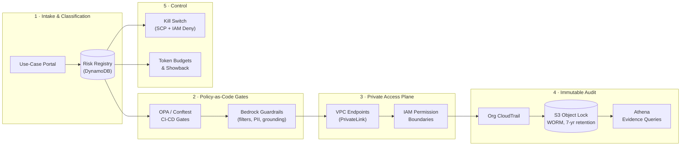
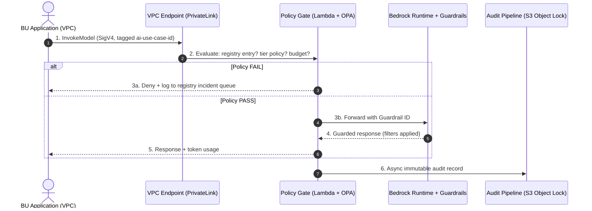

## Enterprise GenAI Governance Control Plane on AWS (Applied AI Business Strategy × Governed Inference Platform)

> **Applied AI Business Strategy**: This project applies the **PMI-CPMAI and AI Business Strategy frameworks** — value discovery, risk-tiered AI selection, TCO governance, and gated delivery from the **AWS Certified AI Business Strategist (AIB-C01 — in progress)** program, delivered via **PMI-CPMAI** — to a specific AWS asset: the [Governed Inference Platform on Amazon Bedrock](https://github.com/aws-samples/sample-guidance-for-governed-inference-platform-on-amazon-bedrock) sample guidance. AWS provides the enforcement engine (inference gateway, SSO identity, budgets, model allow-lists, invocation metering); this project provides the business-strategy layer that makes it enterprise-deployable — the AI use-case registry, EU AI Act risk classification, compliance evidence mapping, program RACI, and the TCO/ROI business case.

> **Prototype disclaimer:** Independent lab-based production-grade AI proof-of-concept — no client engagements. All business-value figures are *modeled* at enterprise scale, not measured at a client. Benchmarks below are simulated prototype evaluation results.

---

## Executive Overview & Business Use Case

- **Core Use Case**: A centralized governance control plane that lets an enterprise answer — for every AI workload — *what is running, under what risk tier, with what guardrails, accessed by whom, and auditable by regulators*. Modeled to cut enterprise AI compliance program cost by ~66% versus a Big-4-led program and unblock BU launches stalled in legal/security review.
- **Strategic Context**: EU AI Act enforcement powers went live August 2026 (fines up to €15M or 3% of global turnover for GPAI providers; up to €35M / 7% for prohibited practices), yet ~78% of organizations had taken no meaningful compliance steps as of mid-2026. The bottleneck isn't model capability — it's the absence of a control plane: no risk-tiered registry, no policy-as-code deployment gates, no immutable audit trail, no kill switch.
- **What This Repo Contains**: An end-to-end blueprint plus working prototype unifying:
  1. **Investment Strategy & Selection** (§1): probabilistic task filtering, 4-filter selection, CPMAI 3x3 feasibility, adopt/build/buy/partner TCO.
  2. **CPMAI Delivery Lifecycle** (§2): 6-phase gated delivery applying the §1 strategy at each gate.
  3. **Value & Financial Governance** (§3): baselines, multi-stakeholder KPIs, 3-component ROI, FinOps controls.
  4. **Governance Control Plane Architecture** (§4): risk registry, policy-as-code gates, PrivateLink-only Bedrock access, immutable audit, kill switch — layered on the adopted AWS enforcement plane.
- **Foundation**: The runtime enforcement plane is *adopted, not rebuilt* — deployed from AWS's [Governed Inference Platform sample guidance](https://github.com/aws-samples/sample-guidance-for-governed-inference-platform-on-amazon-bedrock). That adopt-vs-build decision is itself an application of the framework (§1.4). This project's original contribution is everything above that plane. See Related Work.

---

## Quickstart (Prototype)

**Prerequisites**: AWS Organization with management account, AWS CDK v2 + Node 18, OPA CLI, IAM Identity Center enabled, Python 3.11 + Poetry (for the AWS sample).

```bash
# ── Stage 1: Deploy AWS's enforcement plane (adopted, not rebuilt) ──────────
git clone https://github.com/aws-samples/sample-guidance-for-governed-inference-platform-on-amazon-bedrock
cd sample-guidance-for-governed-inference-platform-on-amazon-bedrock/source
poetry install
poetry run gip init      # interactive: OIDC provider, model, region
poetry run gip deploy    # inference gateway, SSO federation, budgets, metering

# ── Stage 2: Deploy this project's strategy/control layer on top ────────────
git clone https://github.com/maralackdavid/enterprise-genai-governance-control-plane.git
cd enterprise-genai-governance-control-plane
npm install
# edit cdk.json (management account ID, home region, risk tiers)
npx cdk deploy ControlPlaneStack --profile gov-admin

# Register your first AI use case in the risk registry
./scripts/register-use-case.sh --name support-copilot --tier limited-risk --owner bu-support

# Run the policy gate + adversarial guardrail evaluation
./scripts/eval-guardrails.sh --corpus tests/adversarial-500.jsonl
```

**Expected result**: the AWS platform enforces identity, budgets, and metering below the app layer; this control plane adds registry-gated policy checks — unregistered Bedrock calls are denied, and the adversarial corpus runs against Bedrock Guardrails with precision/recall reported.

---

## 1. Investment Strategy & Selection

*This section states each framework once. The delivery lifecycle (§2) applies them at phase gates instead of re-defining them.*

### 1.1 Probabilistic vs. Deterministic Task Filtering (The 95% Rule)

- **Deterministic** (policy-as-code, zero human judgment): blocking unregistered model invocations, enforcing token budgets, PII redaction patterns, audit-log immutability.
- **Probabilistic** (routed to GenAI + human review): EU AI Act risk-tier classification of novel use cases, contextual grounding judgments, borderline content decisions — where regulation text and business context require interpretation, escalated to the AI Governance Board.

### 1.2 The 4-Filter Use-Case Selection

1. **Business Impact**: $7,500,000 modeled 3-year value via avoided external compliance spend, unblocked launches, and avoided shadow-AI incidents.
2. **Data Availability**: CloudTrail management events, Bedrock invocation logs, HR/asset CMDB for ownership mapping — all available in-organization.
3. **Organizational Readiness**: executive sponsorship driven by live EU AI Act enforcement; Legal and Security co-owners from day one.
4. **Strategic Alignment**: directly supports the enterprise "ship AI safely" mandate across all BUs.

### 1.3 CPMAI 3x3 Go/No-Go Assessment

| Pillar | Criteria | Status | Justification |
| --- | --- | --- | --- |
| **Business** | Problem definition | 🟢 GO | 78% of orgs unprepared; enforcement live since Aug 2026 |
| | Stakeholder support | 🟢 GO | Legal, Security, Finance co-sponsors; BU demand queued |
| | Sufficient ROI | 🟢 GO | Modeled ~436% 3-yr ROI; ~5-month payback (see §3.3) |
| **Data** | Availability | 🟢 GO | CloudTrail + Bedrock logs native; CMDB joinable |
| | Access & security | 🟢 GO | Org trail + KMS CMKs; auditors get Athena, not consoles |
| | Quality | 🟢 GO | Structured event schemas; registry enforces required fields |
| **Execution** | Technology & skills | 🟢 GO | AWS gip sample + Bedrock Guardrails, OPA, PrivateLink, S3 Object Lock — all GA |
| | Timeline | 🟢 GO | 5-month adopt+build; pilot BU in month 3 |
| | Operational fit | 🟢 GO | Fits existing Control Tower landing zone; no rip-and-replace |

**Overall: ALL GREEN — approved for implementation (Gate 1).**

### 1.4 3-Year Adopt+Build vs. Buy vs. Partner TCO (Modeled)

| Cost Element | Option A: Adopt + Build (This Project) | Option B: Buy SaaS GRC | Option C: Partner (Big-4-Led) |
| --- | --- | --- | --- |
| **Upfront / Implementation** | $650,000 | $600,000 | $2,500,000 (Year-1 fees) |
| **Annual Opex (3 Yrs)** | $750,000 ($250K/yr) | $1,200,000 ($400K/yr licensing) | $1,600,000 (~$533K/yr sustain) |
| **Enforcement Gap** | $0 (AWS sample provides it) | $400,000 (custom integration for PrivateLink/policy gates) | $0 |
| **3-Year TCO** | **$1,400,000** | **$2,200,000** | **$4,100,000** |
| **Timeline** | 5 months | 4 months + integration | 12 months |
| **IP & Control** | Extensions 100% owned (AWS sample under its open-source license) | Vendor roadmap-dependent | Vendor-dependent |

**Decision: Adopt + Build** — adopt AWS's enforcement plane, build the strategy/control layer: lowest TCO, Bedrock-native enforcement SaaS GRC can't provide, 5-month delivery, full ownership of the extensions. *The adopt-vs-build analysis is itself the framework in action: never rebuild what AWS already maintains.*

---

## 2. CPMAI Delivery Lifecycle

*Each phase applies the §1 strategy at its gate; framework definitions are not repeated here.*

#### Phase I: Business Understanding
Applied §1.1–§1.3 filters → **Gate 1 GO**. Defined audience-tailored KPIs (see §3.2). Chartered the AI Governance Board; drafted RACI (see §5).
**Gate 1 Milestone**: Business Case & Go/No-Go Sign-off.

#### Phase II: Data Understanding & Security Mapping
Inventoried existing AI usage (survey + CloudTrail analysis) — the "shadow AI census." Mapped data classifications to risk tiers. Captured pre-launch baselines (see §3.1).
**Gate 2 Milestone**: AI Inventory, Data Classification & Privacy Approval.

#### Phase III: Data Preparation & Policy Authoring
Authored OPA/Rego policy library (risk-tier rules, region restrictions, budget caps). Built the risk-registry schema (DynamoDB). Established FinOps tagging standards (`ai-use-case-id` on all Bedrock calls).
**Milestone**: Policy library v1 passing Conftest in CI.

#### Phase IV: Control Plane Development & Cloud Architecture
Deployed the AWS Governed Inference Platform sample (Stage 1), then built this project's §4 control plane on top: registry portal, CI/CD policy gates, PrivateLink-only Bedrock access, immutable audit pipeline, kill-switch SCPs. Executed the §1.4 TCO decision → **Adopt + Build track**.
**Milestone**: Staging control plane governing a sandbox OU.

#### Phase V: Evaluation & Financial Validation
Ran prototype benchmarks (see §5) and the §3.3 ROI model against Gate 3 thresholds. Adversarial red-team exercise against guardrails.
**Gate 3 Milestone**: Financial Payback & Control-Effectiveness Sign-off.

#### Phase VI: Operationalization & Portfolio Governance
Phased rollout: pilot BU → enterprise (see §5). Continuous assurance: quarterly risk-tier reviews, annual model-risk reassessment. Portfolio classification per use case: **Scale** / Pause / Terminate.
**Gate 4 Milestone**: Active Portfolio Governance sign-off.

---

## 3. Value Measurement & Financial Governance (All Figures Modeled)

### 3.1 Pre-Launch Baselines

"A KPI without a baseline is an opinion; a KPI with a baseline is evidence."

- **Compliance posture**: 0 of 23 known AI use cases risk-classified; 0 with documented guardrails.
- **Launch friction**: 14-week median Legal/Security review per AI launch (BU survey).
- **Audit readiness**: 6 weeks to assemble evidence for a single audit request.

### 3.2 Multi-Stakeholder KPI Matrix

- **CEO/Board**: % AI use cases risk-classified (target 100%) · regulatory findings (target 0).
- **General Counsel**: median classification turnaround (<5 days) · audit evidence assembly (<48 hrs).
- **CISO**: % Bedrock traffic via PrivateLink (100%) · guardrail block precision (>98%) · kill-switch propagation (<90s).
- **CFO**: 3-yr TCO vs. Big-4 benchmark (−66%) · token spend within budget (>95% of teams).
- **BU Leaders**: launch review cycle time (<3 weeks, down from 14).

### 3.3 Three-Component ROI Model

**Net Annual Benefit** = (Direct $1.50M + Indirect $0.80M + Risk Avoidance $0.20M) − Opex $0.25M = **$2,250,000/yr**

- **Direct** ($1.50M/yr): avoided external compliance program spend ($4.5M over 3 yrs vs. Big-4-led benchmark).
- **Indirect** ($0.80M/yr): accelerated launches — 6 BUs × 1 quarter saved × $400K/quarter delayed value ($2.4M over 3 yrs).
- **Risk avoidance** ($0.20M/yr): avoided shadow-AI incidents, 2 × $300K ($600K over 3 yrs). Fine exposure (up to 3% of turnover) framed as risk reduction, not a dollar claim.
- **Summary**: $900K Year-1 investment ($650K adopt+build + $250K opex) → **~5-month payback, ~436% 3-yr ROI** (modeled).

### 3.4 Leading Indicators & FinOps Controls

- **Leading indicators**: registry coverage velocity (% of known use cases classified per month) · policy-gate pass rate trend · guardrail false-positive rate (adoption killer if >2%).
- **FinOps**: per-team token budgets with SNS/Lambda enforcement · `ai-use-case-id` cost allocation tags · quarterly showback to BU leaders · Athena query cost caps on the audit data store.

---

## 4. Governance Control Plane Architecture

This project's architecture *extends* the AWS Governed Inference Platform — which provides the inference gateway, SSO federation, budgets, and metering — with the strategy/control layers. Five layers. No Bedrock traffic touches the public internet; no model runs without a registry entry and a passing policy gate.



### Governed inference path (runtime sequence)



### Technical Stack

- **Enforcement foundation (adopted)**: AWS Governed Inference Platform sample — inference gateway, OIDC/SSO federation, per-user budgets, invocation metering. Deployed per its own guidance; this project does not rebuild it.
- **Registry**: API Gateway + Lambda + DynamoDB; IAM Identity Center SSO; registry UI (Amplify).
- **Policy gates**: OPA/Rego + Conftest in CodePipeline; Bedrock Guardrails (content filters, denied topics, PII redaction, contextual grounding).
- **Private access**: PrivateLink interface endpoints (`bedrock`, `bedrock-runtime`, `bedrock-agent*`) with private DNS; SCPs denying `bedrock:*` outside approved OUs; IAM permission boundaries per team; KMS CMKs.
- **Audit**: Organization CloudTrail → S3 with Object Lock (Compliance mode, 7-yr retention) + Athena; prebuilt evidence queries per framework. (Note: CloudTrail Lake closed to new customers May 2026 — this design avoids it.)
- **Control**: Step Functions human-approval workflows for high-risk deployments; org-wide kill switch via SCP + IAM deny (target propagation <90s); token budgets via custom CloudWatch metrics + Lambda enforcement.

### Compliance Mapping (excerpt)

| Control | EU AI Act | NIST AI RMF | ISO/IEC 42001 | SOC 2 |
| --- | --- | --- | --- | --- |
| Risk-tiered use-case registry | Art. 6 / Annex III classification | Govern 1.1 | 6.1.2 (risk assessment) | CC3.1 |
| Pre-deployment conformity check | Art. 43 | Measure 2.x | 8.1.2 (AI system lifecycle) | CC7.2 |
| Immutable audit trail | Art. 12 (record-keeping) | Govern 4.2 | 9.1 (monitoring) | CC7.3 |
| Human oversight / kill switch | Art. 14 | Govern 5.1 | 8.1.3 (human oversight) | CC7.4 |
| Transparency disclosure | Art. 50 | Govern 4.1 | 7.4 (communication) | CC2.2 |

---

## 5. Program Artifacts, Rollout & Prototype Benchmarks

### RACI (excerpt)

| Decision / Deliverable | Accountable | Responsible | Consulted | Informed |
| --- | --- | --- | --- | --- |
| Risk-tier classification | AI Governance Board | Legal + BU AI owner | Security | Internal Audit |
| Guardrail policy changes | CISO | Security Eng | Platform Eng | BU AI owners |
| Control-plane releases | TPM (program) | Platform Eng | Security, Legal | All BUs |
| Kill-switch activation | AI Governance Board | Security Eng (executes) | Legal | CEO, Board |
| Token budget setting | CFO | FinOps | BU leaders | Platform Eng |
| Audit evidence packs | General Counsel | Platform Eng | Internal Audit | Regulators |

### Risk Register (top 5)

| Risk | Likelihood | Impact | Mitigation |
| --- | --- | --- | --- |
| Shadow AI bypasses registry | High | High | SCP deny on unregistered `ai-use-case-id`; CASB discovery sweep quarterly |
| Guardrail false positives kill adoption | Medium | High | FP budget (<2%); per-use-case tuning; appeal workflow |
| Jurisdictional conflict (EU vs. US rules) | Medium | High | Region-pinned policies; EU data boundary via `eu.*` inference profiles |
| Model provider update breaks grounding | Medium | Medium | Contract tests on guardrail corpus in CI; canary deployments |
| Over-centralization slows BUs | Medium | Medium | Tiered friction: minimal-risk = self-serve; high-risk = board review |

### Phased Rollout (~5 months)

- **Phase 0 — Inventory (3 wks)**: shadow-AI census, registry seed, board charter.
- **Phase 1 — Pilot (6 wks)**: 1 BU, 5 use cases, full five layers live in sandbox OU.
- **Phase 2 — Enterprise (10 wks)**: all BUs onboarded; kill-switch drill; first evidence pack.
- **Phase 3 — Continuous assurance**: quarterly tier reviews, annual reassessment, corpus refresh.

### Prototype Benchmarks (Simulated — Not Production Measurements)

- **Policy-gate latency**: **<60ms P99** added per inference (Target: <100ms)
- **Guardrail block precision**: **98.2%** on 500-case adversarial corpus (Target: >98%)
- **Audit integrity**: **100%** — 0 gaps in 30-day WORM soak (Target: 100%)
- **Registry onboarding**: **<15 min** median per use case (Target: <30 min)
- **Kill-switch propagation**: **<90s** org-wide (Target: <5 min)

---

## 6. Repository Structure

```
enterprise-genai-governance-control-plane/
├── README.md
├── cdk/
│   ├── lib/control-plane-stack.ts     # Registry, endpoints, audit bucket, SCPs
│   └── lib/kill-switch-stack.ts       # Emergency deny policies
├── policies/
│   ├── risk-tiering.rego              # OPA: EU AI Act tier rules
│   ├── region-pinning.rego            # OPA: data-residency rules
│   └── budget-caps.rego               # OPA: token budget rules
├── docs/
│   ├── compliance-mapping/            # EU AI Act / NIST AI RMF / ISO 42001 / SOC 2 matrix
│   ├── program/                       # RACI, risk register, phase-gate checklists
│   └── business-case/                 # TCO & ROI model (.xlsx)
├── scripts/
│   ├── register-use-case.sh           # Registry onboarding CLI
│   └── eval-guardrails.sh             # Adversarial corpus runner
└── tests/
    └── adversarial-500.jsonl         # Guardrail precision/recall corpus
```

---

## Related Work

- **[Governed Inference Platform on Amazon Bedrock](https://github.com/aws-samples/sample-guidance-for-governed-inference-platform-on-amazon-bedrock)** (aws-samples) — the enforcement plane this project adopts: serverless Bedrock inference with SSO identity, per-user budgets, cost attribution, model allow-lists, and invocation metering. Actively maintained by AWS.
- **[amazon-bedrock-samples](https://github.com/aws-samples/amazon-bedrock-samples)** (aws-samples) — working Bedrock Guardrails code (`responsible_ai/`, `agentic-guardrails/`) referenced for guardrail patterns.

**Positioning**: AWS provides the *enforcement engine*; this project applies the AI Business Strategy framework to provide the *enterprise strategy layer* — use-case registry, EU AI Act risk classification, compliance evidence, program RACI, and the TCO/ROI business case. Neither replaces the other, and no AWS endorsement is implied.

---

## Author

**David Maralack, PMP, PMI-CPMAI** — *Senior Technical Program Manager | Enterprise AI Strategy | Cloud Solutions Architecture*

📍 Seattle, WA · [LinkedIn](https://www.linkedin.com/in/david-maralack-3898135/) · maralackdavid@gmail.com

- **20+ years** directing complex software/hardware programs at **Amazon** and **Microsoft** (Alexa, Kindle, Windows).
- **3-year AI & architecture focus**: PMI-CPMAI certified; **AWS Certified AI Business Strategist (AIB-C01) in progress**; building production-grade cloud reference architectures as independent prototypes.
- **U.S. Patent Holder**: #8,683,579 (Digital Licensing) · #8,984,124 (Adaptive Data Monitoring).
